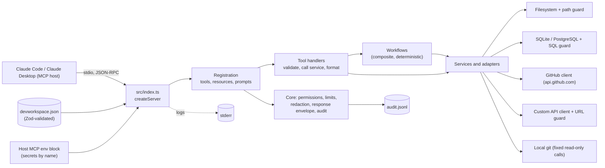

# DevWorkspace MCP

A local-first [Model Context Protocol](https://modelcontextprotocol.io) server (TypeScript, stdio) that gives
Claude Code (and, untested, Claude Desktop) controlled access to five capability packs: database, GitHub,
custom API, filesystem, and multi-service workflows.

It is a portfolio project. The design goal is the opposite of "give the model a shell": every integration is
**read-only by default**, limited to what you list in one JSON config file, and fails closed when a list is
empty or a value is unknown.

- Free only: no paid service, plan or API. The server never calls a model API; composite tools are
  deterministic and Claude interprets their structured results.
- No secrets in files: the config holds environment variable **names**; values come from the host's MCP `env`
  block.
- Not required: Docker, Supabase, or any hosted service.

Status: 29 tools, 5 resource URIs, 5 prompts in total (the shipped example enables a subset: 15 tools, 4 resource
URIs, 4 prompts). The automated test suite runs against mocks and local
fixtures. **Not yet verified live:** the real GitHub API, the real Claude Code / Claude Desktop hosts, Windows and
macOS (see [Known limits](#known-limits)).

## Contents

1. [Requirements and install](#requirements-and-install)
2. [Connect a host](#connect-a-host)
3. [Tools, resources, prompts](#tools-resources-prompts)
4. [Configuration reference](#configuration-reference)
5. [Security](#security)
6. [Architecture](#architecture)
7. [Example prompts](#example-prompts)
8. [Demo scenarios A-C](#demo-scenarios-a-c)
9. [Troubleshooting](#troubleshooting)
10. [Docker](#docker)
11. [Development](#development) and [Known limits](#known-limits)

## Requirements and install

| Requirement | Notes |
|---|---|
| Node.js >= 22 | `engines.node` is `>=22`. Developed and tested on Node 22.21 (Linux/WSL2). |
| pnpm | The repo pins `pnpm@10.22.0` in `package.json` (`packageManager`). With Corepack: `corepack enable`. |
| Native build for `better-sqlite3` | The SQLite adapter uses the native module `better-sqlite3`. pnpm is allowed to run its install script (`onlyBuiltDependencies` in `pnpm-workspace.yaml`). It normally installs a prebuilt binary; if none matches your OS/Node version, a C++ toolchain and Python are needed to compile it (Linux: `build-essential`; macOS: Xcode Command Line Tools; Windows: Visual Studio Build Tools). Only tested on Linux (WSL2). |
| Git | Optional. Used read-only for local repository metadata (`workspace_get_overview`). |

The install steps are the same on every OS; run them in a terminal (on Windows prefer PowerShell or WSL):

```bash
git clone <REPOSITORY-URL-PLACEHOLDER> devworkspace-mcp   # clone URL not decided yet; or copy the project folder
cd devworkspace-mcp   # the repository root is the pnpm workspace root
pnpm install
pnpm build
pnpm sample:db   # optional: creates the demo SQLite database used by the example config
```

`pnpm build` compiles `packages/server` to `packages/server/dist/index.js`. That file is what the host runs.

Platform status: Linux/WSL2 is the only platform exercised so far. macOS and native Windows should work for the
pure-JS parts but are **untested**; the native `better-sqlite3` build is the main risk there.

### Check that it starts

Run the server by hand against the shipped example config (the filesystem pack on a tiny sample folder, plus the
read-only SQLite connection `local-sqlite`; run `pnpm sample:db` first so that database file exists). It waits for MCP messages on stdin; press Ctrl+D or Ctrl+C to stop:

```bash
cd packages/server
node dist/index.js --config config/devworkspace.example.json
# stderr shows: {"level":"info","msg":"devworkspace-mcp ready on stdio"}
# the counts ("tools":15,"resources":4,"prompts":4) are logged only after a client sends its first message
```

Without `--config` and without `DEVWORKSPACE_CONFIG` it exits with code 1 and a message such as
`no config file specified: pass --config <path> or set DEVWORKSPACE_CONFIG`. There is no fallback to the
working directory, because hosts start servers from unpredictable directories.

## Connect a host

Use **absolute paths** everywhere. Make your own config from the example; the real config file
(`packages/server/config/devworkspace.json`) is git-ignored:

```bash
cp packages/server/config/devworkspace.example.json packages/server/config/devworkspace.json
# edit the copy: workspaces[].rootPath and filesystem.allowedRoots (relative paths resolve against the config file's folder)
```

### Claude Code (WSL / Linux) - the supported host

Claude Code CLI syntax (see <https://code.claude.com/docs/en/mcp>; `claude mcp add --help` agrees):

```bash
claude mcp add --transport stdio devworkspace -- \
  node /abs/path/to/project/packages/server/dist/index.js \
  --config /abs/path/to/project/packages/server/config/devworkspace.json
```

With secrets, pass them with `--env` (names and values are stored by Claude Code in its own settings, not in this
repo), placed before the server name:

```bash
claude mcp add --transport stdio --env GITHUB_TOKEN=<your-token> devworkspace -- node /abs/.../dist/index.js --config /abs/.../devworkspace.json
```

Or use a project `.mcp.json` that refers to a variable by name (Claude Code expands `${VAR}` from your shell
environment, so the secret is not written to the file):

```json
{
  "mcpServers": {
    "devworkspace": {
      "command": "node",
      "args": [
        "/abs/path/to/project/packages/server/dist/index.js",
        "--config",
        "/abs/path/to/project/packages/server/config/devworkspace.json"
      ],
      "env": { "GITHUB_TOKEN": "${GITHUB_TOKEN}" }
    }
  }
}
```

Verify: `claude mcp list` (health check), then inside a session run `/mcp`, and ask Claude to call
`server_get_status`. Remove with `claude mcp remove devworkspace`. Rebuild (`pnpm build`) after pulling changes and
restart the session.

### Claude Desktop - untested / optional

Not part of the current acceptance scope (the project's host decision is Claude Code in WSL). The entry below follows
the generic MCP format from <https://modelcontextprotocol.io/docs/develop/connect-local-servers> and has **not been
run** against this server. Config file locations: macOS `~/Library/Application Support/Claude/claude_desktop_config.json`,
Windows `%APPDATA%\Claude\claude_desktop_config.json`, Linux `~/.config/Claude/claude_desktop_config.json`
(Settings > Developer > Edit Config; fully quit and restart Claude Desktop afterwards).

```json
{
  "mcpServers": {
    "devworkspace": {
      "command": "node",
      "args": ["/abs/path/to/project/packages/server/dist/index.js", "--config", "/abs/path/to/devworkspace.json"],
      "env": { "GITHUB_TOKEN": "<set only if you enable GitHub>" }
    }
  }
}
```

Windows Claude Desktop with the project inside WSL has no official example and is unverified. Community guides use
`"command": "wsl.exe"` with args that start the Linux `node`, and `env` values are not forwarded into WSL unless
listed in `WSLENV`. Treat that route as experimental.

### Environment variables

The server reads the environment only from the process the host starts (the host's MCP `env` block). It does
**not** load `.env` files and has no dotenv dependency. The names used by the example config are in
`.env.example` (names only, no values):

| Variable | Used for |
|---|---|
| `DEVWORKSPACE_CONFIG` | Config file path when `--config` is not passed (`--config` wins) |
| `DEVWS_PG_URL` | PostgreSQL connection string (`databases[].connectionStringEnv`) |
| `GITHUB_TOKEN` | GitHub token (`github.tokenEnv`); optional, see below |
| `SAMPLE_API_TOKEN` | Bearer token for the sample custom API (`customApis[].auth.tokenEnv`) |

Optional, your own choice: Node can load a file itself, for example `node --env-file=/abs/path/.secrets.env
dist/index.js --config ...` (Node >= 20.6; keep that file outside the repo). The server does not depend on it.

## Tools, resources, prompts

A pack's tools are registered only when the pack is enabled; the composite `workspace_*` tools only when the packs
they need are enabled. All 29 tools are read-only except that `api_call_endpoint` is annotated as non-read-only when a profile has a write-type endpoint (those calls are denied unless writes are enabled, see below). Every result uses one JSON envelope
(`success`, `data`, `meta` with `truncated`/`partial`/counts, `warnings`, or `error` with a stable code) and is
bounded; truncation is always reported in `meta`.

| Pack | Tools |
|---|---|
| Status (always) | `server_get_status` |
| Filesystem (6) | `fs_list_directory`, `fs_get_file_info`, `fs_read_file`, `fs_search_files`, `fs_search_content`, `fs_get_directory_tree` |
| Database (6) | `db_list_connections`, `db_list_tables`, `db_describe_table`, `db_list_relationships`, `db_execute_readonly_query`, `db_explain_query` |
| GitHub (8) | `github_list_repositories`, `github_get_repository`, `github_list_issues`, `github_get_issue`, `github_list_pull_requests`, `github_get_pull_request`, `github_list_commits`, `github_get_commit` |
| Custom API (3) | `api_list_profiles`, `api_get_endpoint_info`, `api_call_endpoint` |
| Workflows (5) | `workspace_get_overview` (filesystem), `workspace_summarize_activity` (GitHub), `workspace_find_issue_context` (GitHub + filesystem), `workspace_inspect_data_flow` (filesystem + database or API), `workspace_generate_change_plan` (GitHub + filesystem) |

Notes:
- Database queries accept a single SELECT (including `WITH ... SELECT`); `db_explain_query` never uses `ANALYZE`.
- No GitHub write tools exist. `api_call_endpoint` stays registered and denies write-type endpoints unless
  `permissions.allowWrites` is true and the exact entry `api:<profile>/<endpoint>` is in
  `permissions.writeOperations`.
- Composite workflows return `sections` with a status per source (`ok`, `partial`, `unavailable`, `disabled`,
  `error`) and a source attribution, so a failed or disabled integration shows up as such instead of being hidden.
  They apply a global deadline (`workflowTimeoutMs`, default 30 s).
- Local git metadata in the overview uses fixed read-only `git` calls (no shell, no user-supplied arguments).

### Resources

Registered only for enabled packs; contents are the same JSON envelope as the matching tool, redacted and size-bounded,
without absolute paths or secrets.

| URI | Pack | Content |
|---|---|---|
| `workspace://list` | any pack enabled | Configured workspace ids/names and enabled links |
| `workspace://{workspaceId}/overview` | filesystem | Same as `workspace_get_overview` |
| `filesystem://{workspaceId}/tree` | filesystem | Directory tree, depth up to 3 |
| `github://{owner}/{repository}/summary` | GitHub | Metadata plus up to 10 open issues, PRs and commits; allowlisted repositories only |
| `database://{connectionName}/schema` | database | Up to 25 tables described plus relationships (metadata only, no rows) |

### Prompts

Static templates that tell the host which tools to call and to separate confirmed facts from inferences. A prompt
appears only when the pack it needs is enabled; steps naming a tool that is not registered are left out.

| Prompt | Arguments | Needs |
|---|---|---|
| `review_project_health` | `workspace?` | filesystem |
| `understand_repository` | `workspace?` | filesystem |
| `investigate_github_issue` | `repo` (`owner/repo`), `issueNumber`, `workspace?` | GitHub |
| `understand_database_schema` | `connection` | database |
| `prepare_change_plan` | `goal`, `workspace?`, `issueNumber?` | filesystem |

Argument values are embedded as quoted data, never as instructions or configuration.

## Configuration reference

One JSON file. Unknown keys are rejected (a typo cannot silently disable a safety setting) and the server refuses to
start on any error, naming the JSON path but never a secret value. Relative paths resolve against the config file's
folder, not the working directory. The shipped file is `packages/server/config/devworkspace.example.json`.

| Section | Keys | Notes |
|---|---|---|
| `server` | `name`, `logLevel`, `auditLogPath` | Logs go to stderr. `auditLogPath` is a JSONL file of tool-call metadata (no arguments, no contents). The example writes `config/audit/audit.jsonl` (git-ignored). |
| `permissions` | `defaultMode: "read-only"`, `allowWrites: false`, `writeOperations: []` | Writes need `allowWrites: true` **and** the exact operation name in `writeOperations`. |
| `limits` | optional overrides | Overrides may only **tighten** defaults. Defaults: request timeout 15 s, DB query timeout 10 s, 100 DB rows, 200 000 bytes per file read and per result, 100 list/search results, 30 s workflow deadline (key names in `src/core/limits.ts`). |
| `workspaces[]` | `id`, `name`, `rootPath`, optional `github` (`owner/repo`), `databases[]`, `apis[]` | `rootPath` must resolve (symlinks followed) inside `filesystem.allowedRoots`. Links must name existing entries. |
| `filesystem` | `enabled`, `allowedRoots`, `blockedNames`, `unblock`, `ignoreDirs`, `allowedExtensions`, `maxFileBytes` | Disabled by default except in the example. `maxFileBytes` cannot exceed 200000. |
| `databases[]` | `name`, `type` (`sqlite`/`postgres`), `enabled`, `readOnly: true`, SQLite `databasePath`; Postgres `connectionStringEnv` (or host/port/database/user with `passwordEnv`), `schemas` | `readOnly: false` is rejected. Connection strings are never accepted in config or tool arguments, only env var names. |
| `github` | `enabled`, `tokenEnv`, `apiBaseUrl` (fixed `https://api.github.com`), `allowedRepositories`, `allowedOwners` | Both allowlists empty = every `github_*` tool is denied. |
| `customApis[]` | `name`, `enabled`, `baseUrl`, `allowPrivateNetwork`, `auth` (`none` / `bearer` + `tokenEnv` / `header` + `headerName` + `valueEnv`), `allowedMethods`, `timeoutMs`, `maxResponseBytes`, `sensitiveFields`, `endpoints[]` | Endpoints declare `name`, `method`, `path` (template like `/items/{id}`), `description`, `permission` (`read`/`write`) and a small JSON-schema subset for `pathParams`, `query`, `body`. Invalid endpoint schemas fail startup. |

Every pack defaults to `enabled: false`. The shipped example enables the filesystem pack on
`test/fixtures/sample-workspace` and the read-only SQLite connection `local-sqlite` (`./data/sample.db`, relative to the
config file, created by `pnpm sample:db`; the file is git-ignored). The PostgreSQL, GitHub and sample API entries are
present but disabled. To use one, set `enabled` to `true` and supply what it needs (the env var, an allowlisted
repository, a reachable API). If `sample.db` has not been generated the server still starts; `db_*` calls return
`INTEGRATION_UNAVAILABLE`.

## Security

- **Read-only by default.** `allowWrites` is `false`; database access is SELECT-only; no GitHub write tool exists; custom
  API write endpoints are denied unless explicitly enabled twice (global flag plus exact operation name). A write tool
  that is not allowed is not registered at all.
- **Least privilege.** Only configured workspaces, connections, repositories and API profiles are reachable. Tool
  arguments name an item from the configuration; they can never add a path, URL, host, header, connection string or
  repository. There is no shell execution and no generic HTTP proxy.
- **Fail closed.** Unknown names, empty GitHub allowlists, unparseable SQL, invalid config and unsupported endpoint
  schemas all deny or stop startup instead of falling back to permissive behaviour.
- **Filesystem.** Paths are workspace-relative; absolute paths, `..`, encoded traversal (`%2e`, `%2f`), backslashes and
  NUL are rejected; symlinks are resolved and must stay inside the workspace root; hardlinks to outside files are
  refused. Secret-like files (`.env*` except `.env.example`, `*.pem`, `*.key`, `id_rsa*`, `.ssh/`, `.aws/`, `*secret*`,
  `.git/` internals and more) are never listed, searched or read. Binary files return `UNSUPPORTED`. Size, depth,
  scanned-file and result limits apply.
- **Database.** The SQL is parsed and must be exactly one SELECT; writes, DDL, `PRAGMA`, `ATTACH`, multiple statements and
  data-modifying CTEs are rejected. SQLite opens read-only with `query_only`, and queries run in a child process that is
  killed on timeout. PostgreSQL queries run in a read-only transaction with a statement timeout.
  **PostgreSQL requires a read-only role:** use a database role that has only `CONNECT`, `USAGE` and `SELECT` on what you
  want visible. The `schemas` setting filters the list/describe tools but is **not** a security boundary for
  `db_execute_readonly_query`, which reads whatever the role can read. Rows may contain personal data; limits apply, but
  there is no automatic PII redaction (an operator responsibility).
- **GitHub.** The base URL is fixed to `https://api.github.com`; owner/repo are validated, then compared with the
  allowlist before any request; redirects are re-checked against the allowlist. The token comes from the env var named in
  `tokenEnv`; if it is unset, only unauthenticated public reads are attempted (with a startup warning). Issue and PR text is
  untrusted data returned as-is, truncated.
- **Custom API.** URLs are built only from the configured `baseUrl` plus the endpoint template; path parameters are
  validated; only configured endpoints can be called; redirects are not followed; the destination IP is checked and pinned
  (SSRF/DNS-rebinding protection). Loopback and private addresses need `allowPrivateNetwork: true` on that profile; cloud
  metadata addresses are always blocked. Response bodies are size-capped and `sensitiveFields` and your token are
  redacted. Auth headers come from env vars, never from tool input.
- **No secrets leak.** Secret values are scrubbed from logs, errors, audit entries and results. Errors carry a stable
  code and a safe message, never a stack trace or an upstream body. stdout carries only MCP JSON-RPC.
- **Prompt injection.** Content from files, issues and APIs is untrusted. The server returns it as data and never acts on
  it; because tool permissions come from your config and not from arguments, injected instructions cannot widen access.
- **Audit log.** Each tool/resource call appends metadata (time, tool, resource reference, outcome, error code, duration,
  write flag) to the JSONL file, without arguments, SQL text or contents.

The full control list and test matrix is in the project documentation (`docs/implementation-notes.md` and the
`test/security/` suites).

## Architecture



Source layout under `packages/server/src`: `config/` (schema, loader), `core/` (permissions, limits, redaction,
response, audit, logger), `integrations/` (filesystem, database, github, custom-api, git), `tools/` (thin handlers per
pack), `workflows/` (composite logic), `resources/`, `prompts/`, `server/` (wiring). Tool handlers only validate, call a
service and format the result; workflows call services, never raw clients.

## Example prompts

Filesystem:
- "List the workspace `sample-project` and read its README. Show me where the greeting is implemented."
- "Search the workspace for `greet` and show the matching lines."

Database (works with the shipped example after `pnpm sample:db`):
- "List the tables in `local-sqlite`, describe the `orders` table and its relationships."
- "Run a read-only query that counts rows per status. Do not run any write."

GitHub (after enabling it with an allowlisted repository):
- "Show open issues and pull requests in `example-org/example-repo`."
- "Summarize recent commits on the default branch."

Custom API (after enabling a profile):
- "List the configured API profiles and describe the `get-health` endpoint, then call it."

Workflows:
- "Give me an overview of workspace `sample-project`."
- "Find files related to issue 12 in `example-org/example-repo` and draft a change plan. Do not modify anything."

You can also use the built-in prompts from the host's prompt menu (for example `review_project_health`).

## Demo scenarios A-C

These follow the scenarios in the project requirements. With the shipped example config the filesystem pack and the
sample SQLite database are enabled, so Scenario A and the database walk-through below run as-is and show how missing
integrations are reported honestly. Scenario B needs a GitHub repository and token that you provide; Scenario C needs an
API process that you provide (none ships).

### Scenario A - Understand a project (runs with the example config)

1. `pnpm build` and `pnpm sample:db`, then add the server with the example config (see [Connect a host](#connect-a-host)).
2. Prompt:
   > Give me an overview of the sample workspace. Inspect its directory structure, recent GitHub activity, and
   > configured database schema. Clearly separate confirmed facts from unavailable information.
3. Expected: Claude calls `workspace_get_overview` and/or the `fs_*` tools. The directory structure is returned as
   confirmed facts, and the database section reports the `local-sqlite` connection (read-only, 5 tables/views). The
   GitHub section comes back as `disabled` and the local git section as `unavailable` (the sample folder is not a git
   repository), and Claude should say so instead of guessing. Enable GitHub in your own copy of the config to fill that section.

### Database walk-through (runs with the example config and `pnpm sample:db`)

The sample database is fictional: `customers`, `products`, `orders`, `order_items` and the view `order_totals`
(seed in `packages/server/scripts/sample-db.sql`).

1. Prompt:
   > List the tables in `local-sqlite`, describe `orders` and its relationships, then count orders per status. Do not
   > run any write.
2. Expected: `db_list_tables`, `db_describe_table`, `db_list_relationships` and `db_execute_readonly_query`
   (`SELECT status, count(*) ... GROUP BY status` gives cancelled 1, pending 1, shipped 2). A write such as
   `DELETE FROM orders` is rejected with `QUERY_REJECTED`. The prompt `understand_database_schema` (argument
   `connection`: `local-sqlite`) and the resource `database://local-sqlite/schema` give the same schema view.

### Scenario B - Investigate an issue (requires GitHub)

1. In your config enable `github`, put your repository in `allowedRepositories`, set `workspaces[].rootPath` to a local
   clone of that repository (inside `filesystem.allowedRoots`), and export `GITHUB_TOKEN` through the host `env` block
   (optional for public repositories, but unauthenticated requests are rate limited).
2. Prompt:
   > Investigate issue #12 in the configured repository. Find relevant files in the local workspace and prepare a change
   > plan. Do not modify any files or remote resources.
3. Expected: `workspace_find_issue_context` and `workspace_generate_change_plan` fetch the issue, search allowed files
   using extracted terms, and return a source-attributed plan that is labelled proposed, not applied. Nothing is changed.

The GitHub integration is tested against a local mock only; it has not been run against the live API.

### Scenario C - Inspect a database-backed API (requires a database and an API)

1. Use the sample database (or PostgreSQL with a read-only role) and enable a custom API profile with a GET endpoint such
   as `get-health`. Link both to the workspace through `workspaces[].databases` and `workspaces[].apis` (the example
   already links `local-sqlite`). The repository ships no API process, so you must run your own API at the profile's
   `baseUrl`; this scenario has not been run end to end.
2. Prompt:
   > Inspect the configured sample API and database schema. Explain which tables appear relevant to the API's health
   > endpoint. Do not run write operations.
3. Expected: `api_get_endpoint_info`/`api_call_endpoint` (GET only) and `db_list_tables`/`db_describe_table`, or
   `workspace_inspect_data_flow`, return evidence; Claude marks conclusions as confirmed (returned by a tool) or inferred.

## Troubleshooting

| Symptom | Cause and fix |
|---|---|
| Server exits with code 1, `Invalid configuration` | Read the listed JSON paths. Common: no `--config`/`DEVWORKSPACE_CONFIG`; unknown key; a workspace `rootPath` outside `allowedRoots`; `readOnly: false`; an inline secret instead of an env var name. |
| Host shows the server as failed / no tools | Run the exact command by hand and read stderr. Check that the path to `dist/index.js` is absolute and that `pnpm build` was run. |
| Garbled protocol / "invalid JSON" in host logs | Something wrote to stdout. The server never does; check for a wrapper script that prints (for example a shell profile echo) or a `node --require` hook. |
| `Cannot find module 'better-sqlite3'` or a native binding error | The native build is missing. Re-run `pnpm install` (a failed rebuild needs a C++ toolchain, see Requirements) and make sure the Node version used by the host is the one you built with. |
| `PERMISSION_DENIED` on a file | It is outside the workspace, blocked (`.env`, keys, `*secret*`, `.git/`), hidden by `ignoreDirs` or `allowedExtensions`, or a link to an outside file. Relative paths only. |
| Tool `NOT_FOUND` for a workspace/connection/profile | The name must exist in the config exactly; list them with `workspace://list`, `db_list_connections`, `api_list_profiles`. |
| All `github_*` tools say `PERMISSION_DENIED` | Both `allowedRepositories` and `allowedOwners` are empty, or the repository is not listed (case-insensitive match). |
| GitHub `INTEGRATION_UNAVAILABLE` or `RATE_LIMITED` | Token rejected (401) or rate limit reached; set a valid token through the host `env` block and retry after `retryAfterSeconds`. Without a token only public repositories can be read. |
| Database `INTEGRATION_UNAVAILABLE` | The file path does not exist or the PostgreSQL env var is missing or the server is unreachable. The message never contains host or password. |
| `QUERY_REJECTED` | The SQL is not a single SELECT, or uses a rejected construct (`PRAGMA`, `ATTACH`, multiple statements, `sqlite_master`). Use `db_list_tables`/`db_describe_table` for schema. |
| `TIMEOUT` on a query | Simplify the query or add filters. Limits can only be tightened. |
| API call `PERMISSION_DENIED` for 127.0.0.1 | Set `allowPrivateNetwork: true` on that profile (cloud metadata addresses stay blocked). |
| `LIMIT_EXCEEDED` | The result cannot be cut safely within `maxResponseBytes`; ask for less data (smaller `limit`, narrower path). |
| Tools missing in the host | The pack is disabled, or the host cached an old list. Enable the pack in the config, restart the server, and for Claude Code re-open the session. |
| Secrets not visible to the server | They must be in the host's MCP `env` block; `.env` files are not read automatically. |

Logs are JSON lines on stderr (Claude Desktop writes them to `mcp-server-<name>.log` per its docs). Set `server.logLevel` for more detail.

## Docker

Docker is **not needed to build, configure or run the server**. It is used only for:

- the PostgreSQL integration tests: `pnpm test:postgres` starts a throwaway local `postgres:16-alpine` container on
  `127.0.0.1` with random credentials and removes it afterwards. If Docker is unavailable it prints `SKIPPED` and
  exits 0, and the normal `pnpm test` skips those tests too;
- optionally, provisioning a local PostgreSQL database for your own use.

Running the MCP server itself inside a container is **not supported and untested**.

## Development

From this folder: `pnpm install`, `pnpm build`, `pnpm dev` (tsx watch), `pnpm test`, `pnpm lint`, `pnpm typecheck`,
`pnpm format`, `pnpm sample:db`. Tests live in `packages/server/test/` (security suites in `test/security/`) and next to sources
(`src/**/*.test.ts`). `apps/web` is the separate landing/docs/demo site and is not part of the server (see Web app below).

## Web app

`apps/web` (package `ik-web`) is a static Next.js site (landing, install, tools reference, security model, demo with
sample data). It has no backend, makes no external requests and is not needed to run the MCP server.

- Develop: `pnpm web:dev`, then open http://localhost:3000
- Build: `pnpm web:build`; the static export is written to `apps/web/out/` (`index.html`, `install.html`, `tools.html`,
  `security.html`, `demo.html`, `404.html`, `_next/`).
- View the build: serve `apps/web/out` with any static server that maps `/install` to `install.html`, for example
  `npx serve apps/web/out` (downloads `serve` on first use) or `python3 -m http.server -d apps/web/out` (then use
  `/install.html`, `/tools.html`, ...).
- Checks: `pnpm web:lint`, `pnpm web:typecheck`. Not deployed yet.

## Known limits

- Live GitHub API behaviour and real MCP hosts (Claude Code, Claude Desktop) are not verified by the automated tests.
- Windows and macOS installs, and the native `better-sqlite3` build there, are untested.
- The sample SQLite database is generated locally (`pnpm sample:db`, not committed). No sample API process ships, so the API demo needs your own.
- `github_list_repositories` returns the first page of an owner's repositories only.
- Documented residual risks: a small race between the path check and the file open; redaction is exact-match, so an
  encoded re-echo of a token is not redacted; PostgreSQL query tools are bounded by the role's grants, not by `schemas`.
